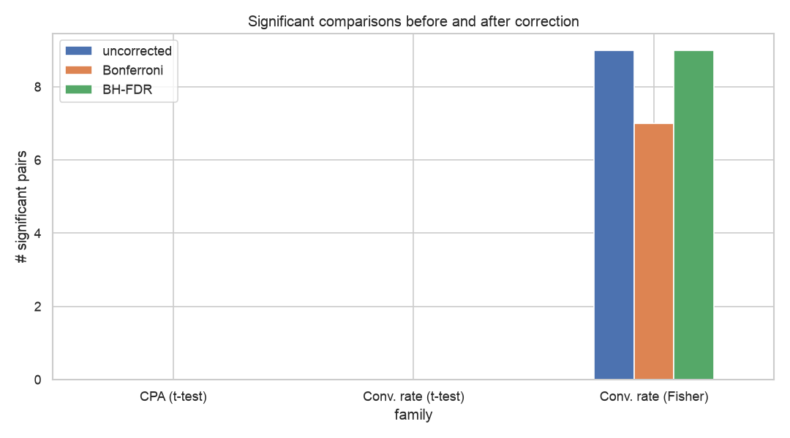
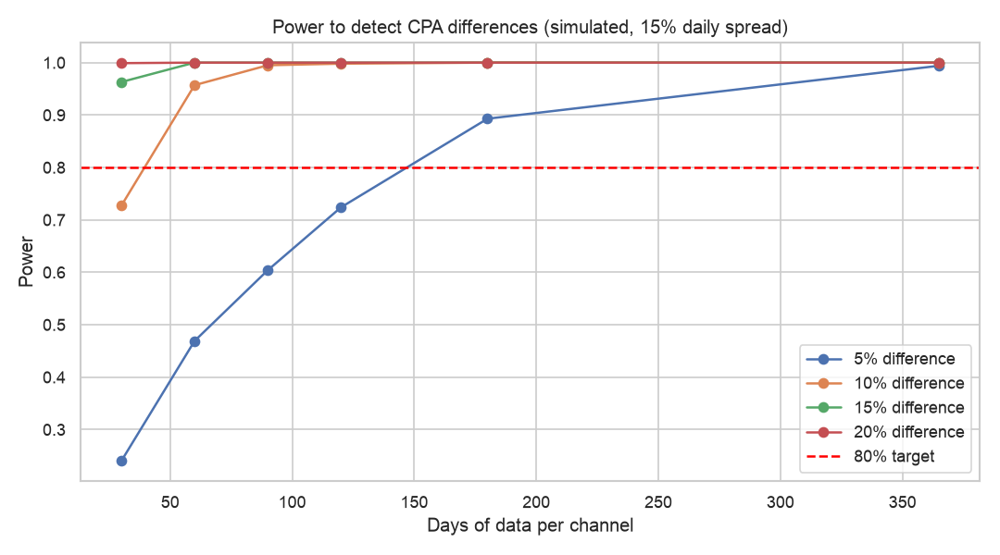
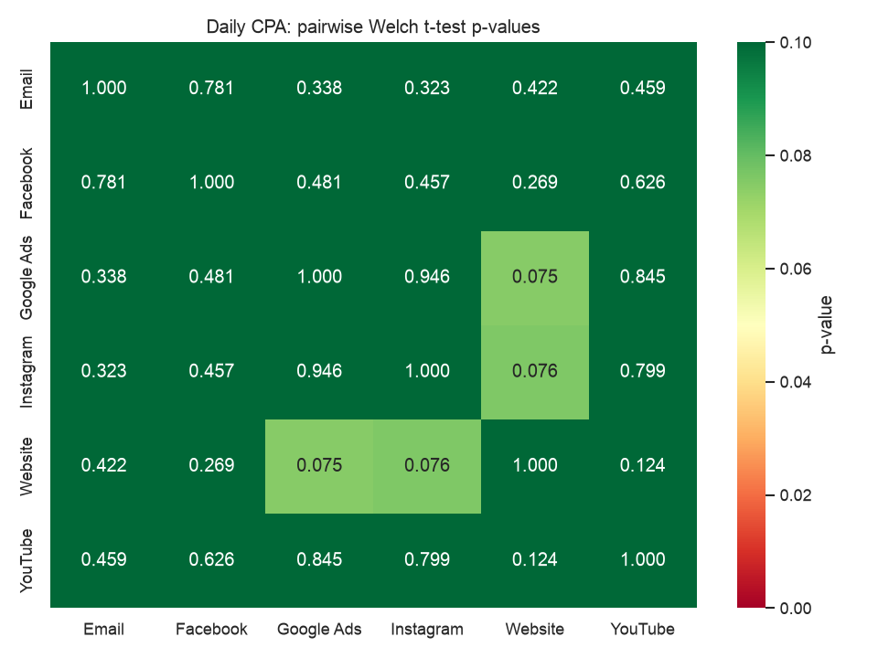

# Lab proof – Marketing channel budget allocation

**Question:** should the CMO move part of the $500K monthly budget between our 6 marketing channels?
**Answer:** no. No channel is reliably cheaper; keep an even split and run a controlled test first. Full reasoning in the [executive memo](outputs/executive_memo.md).

## 1. Code / workflow

All code is in one notebook: [`channel_budget_statistical_analysis.ipynb`](channel_budget_statistical_analysis.ipynb). It runs top to bottom with **Run All**.

| Part | What it does |
|---|---|
| 1 – Explore | Load Kaggle data, clean, aggregate to channel × day, compute CPA / ROAS / conversion rate |
| 2 – Compare | Welch t-tests + Cohen's d on daily CPA and conversion rate; Fisher's exact test on total conversions |
| 3 – Correct | Bonferroni and Benjamini-Hochberg correction across 3 families of 15 tests |
| 4 – Power | Simulated power for 5–20% CPA gaps; minimum days for 80% power |
| 5 – Recommend | Bootstrap 95% CIs, composite ranking, $500K allocation, executive memo |

## 2. One run with its input

- **Input:** [Marketing Campaign Performance Dataset](https://www.kaggle.com/datasets/manishabhatt22/marketing-campaign-performance-dataset), 200,000 campaign rows.
- **Cleaning:** cost parsed from text (`"$12,500.00"`), conversions derived as conversion rate × clicks, revenue as cost × (1 + ROI). 0 missing values, 0 impossible rows removed.
- **Analysed data:** [`outputs/marketing_data.csv`](outputs/marketing_data.csv): 6 channels × 365 days (1 Jan – 31 Dec 2021).

## 3. Evidence

**Multiple-comparison correction**

| Family | Tests | Uncorrected | Bonferroni | BH-FDR |
|---|---|---|---|---|
| CPA (Welch t-test) | 15 | 0 | 0 | 0 |
| Conversion rate (Welch t-test) | 15 | 0 | 0 | 0 |
| Conversion rate (Fisher) | 15 | 9 | 7 | 9 |

**Power:** 365 days detect any CPA gap ≥5% with ≥80% power (5% needs ~145 days). The largest observed gap (Google Ads vs Website, 1.12%) has power 0.17 and would need ~2,630 days.

**CPA p-values:** all pairs non-significant; closest are Website vs Google Ads (p = 0.075) and Website vs Instagram (p = 0.076).

**Bootstrap 95% CIs for mean daily CPA** all overlap (Website $281.05–286.04 … Instagram $284.45–289.48).

## 4. Final output

[`outputs/executive_memo.md`](outputs/executive_memo.md): keep an even split (~$83K per channel). The rank-based method would have given Website $131K and Instagram $35.7K (3.7×) based on differences that are statistically noise.

## 5. Failure / limitation I hit

- **Inverted heatmap colours.** My first heatmap used `cmap="RdYlGn_r"` (as the instructions suggested), which shows *high* p-values in red. The whole chart looked "significant" when nothing was. Fixed by switching to `RdYlGn`, so red = low p = significant. Lesson: check that a chart's encoding matches its meaning before reading it.
- **Synthetic dataset.** The channels are almost identical by construction, conversions and revenue had to be derived, and absolute spend (~$417M per channel per year) doesn't match the $500K/month scenario. Only relative differences are used, and conclusions would need confirming on real company data.
- **Kernel state.** After a kernel restart, later cells failed with `NameError: name 'paid' is not defined`; solved by always using Run All so the notebook is reproducible from top to bottom.
