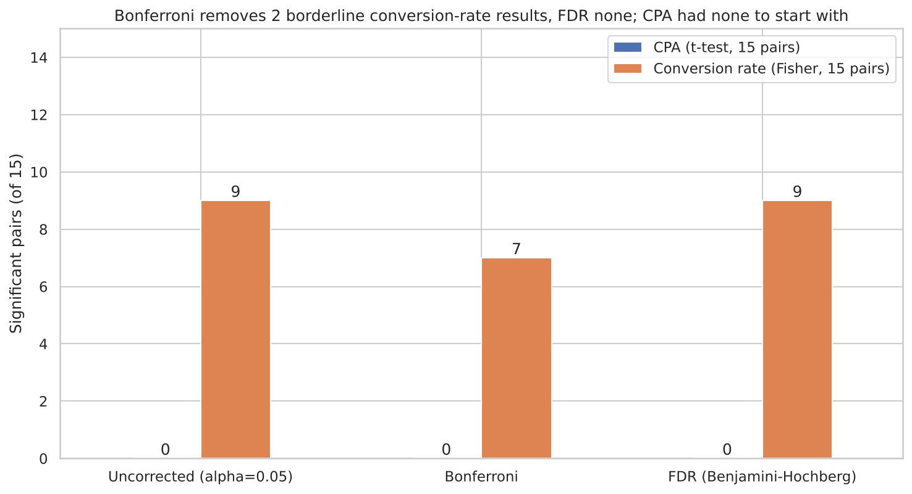
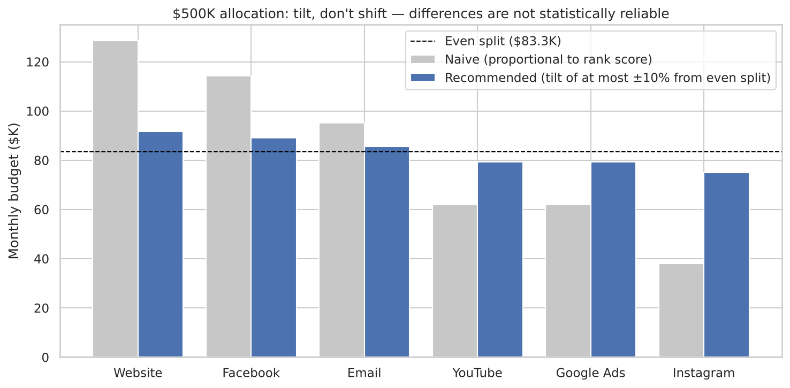

# Lab proof: In God we trust, everyone else bring the data

**Analyst:** Elif Yurdakul · **Dataset:** [Marketing Campaign Performance Dataset (Kaggle)](https://www.kaggle.com/datasets/manishabhatt22/marketing-campaign-performance-dataset) · 200,000 campaigns, 6 channels, 2021

**Bottom line:** no channel is reliably cheaper per acquisition. CPA spans $282–$285, and no pair differs significantly even before correction. Keep the $500K close to an even split, tilting at most ±10%, and test the tilt for 90 days. Full reasoning: [`executive_memo.md`](./executive_memo.md).

## 1. Workflow

```
scripts/download_dataset.py      Kaggle -> data/raw/marketing_campaign_dataset.csv (200,000 rows)
        |
data_exploration.ipynb           parse cost, derive conversions & revenue, aggregate to channel x day
        |                        -> data/marketing_data.csv (2,190 rows), outputs/channel_summary.csv
statistical_analysis.ipynb       15 pairs x (t-tests on CPA, conversion rate, ROAS) + Fisher on conversions
        |                        Bonferroni + Benjamini-Hochberg -> outputs/pairwise_*.csv
power_analysis.ipynb             1,000-simulation power curves, minimum days, adequacy of observed gaps
        |
business_recommendations.ipynb   FDR findings, bootstrap CIs, composite score, $500K allocation
        |
executive_memo.md                decision, caveats, next steps
```

Every notebook is committed with its outputs. Run order and setup are in [`README.md`](./README.md).

| Rubric step | Where |
|---|---|
| 1 Find dataset | [`data_exploration.ipynb`](./data_exploration.ipynb), first cell |
| 2 Load & explore | [`data_exploration.ipynb`](./data_exploration.ipynb), data saved to [`data/marketing_data.csv`](./data/marketing_data.csv) |
| 3 Key metrics | [`data_exploration.ipynb`](./data_exploration.ipynb), [`figures/group_metrics_overview.png`](./figures/group_metrics_overview.png), [`figures/group_distributions.png`](./figures/group_distributions.png) |
| 4 t-tests + Cohen's d | [`statistical_analysis.ipynb`](./statistical_analysis.ipynb), [`figures/metric_comparison_heatmap.png`](./figures/metric_comparison_heatmap.png) |
| 5 Fisher's exact | [`statistical_analysis.ipynb`](./statistical_analysis.ipynb), [`figures/rate_comparison.png`](./figures/rate_comparison.png) |
| 6 Corrections | [`statistical_analysis.ipynb`](./statistical_analysis.ipynb), [`figures/correction_comparison.png`](./figures/correction_comparison.png), [`outputs/correction_summary.csv`](./outputs/correction_summary.csv) |
| 7 Power analysis | [`power_analysis.ipynb`](./power_analysis.ipynb), [`figures/power_analysis_cpa.png`](./figures/power_analysis_cpa.png), [`outputs/minimum_sample_size.csv`](./outputs/minimum_sample_size.csv) |
| 8 Recommendations | [`business_recommendations.ipynb`](./business_recommendations.ipynb), [`executive_memo.md`](./executive_memo.md), [`outputs/budget_allocation.csv`](./outputs/budget_allocation.csv) |

## 2. One run with its input

**Fisher's exact test: Email vs YouTube conversion rate** (`statistical_analysis.ipynb`, Step 5)

Input: the 2×2 contingency table of pooled 2021 clicks.

| | Conversions | Non-conversions | Clicks |
|---|---|---|---|
| Email | 1,485,425 | 17,008,538 | 18,493,963 |
| YouTube | 1,463,649 | 16,886,758 | 18,350,407 |

```python
odds_ratio, p = fisher_exact([[1485425, 17008538], [1463649, 16886758]], alternative="two-sided")
```

Output: conversion rates 8.0319% vs 7.9761%, difference −0.056 pp (−0.70%). Odds ratio 1.0076, p = 4.26e-10, FDR-adjusted p = 6.39e-09, significant under Bonferroni too.

**Reading it:** this is the most significant result in the lab and one of the least useful. The difference is real, but even moving the whole budget from YouTube to Email would gain only about 12 conversions a month. The daily t-test on the same pair gives p = 0.15. See section 5 below.

## 3. Evidence produced

| Test family | Pairs | Uncorrected p < 0.05 | Bonferroni | FDR (BH) |
|---|---|---|---|---|
| CPA, t-test | 15 | 0 | 0 | 0 |
| Conversion rate, Fisher | 15 | 9 | 7 | 9 |
| Conversion rate, daily t-test | 15 | 0 | 0 | 0 |
| ROAS, t-test | 15 | 2 | 0 | 0 |

- **Effect sizes:** all CPA Cohen's d < 0.14 (negligible). The largest across all metrics is 0.20 (ROAS, Facebook vs Instagram).
- **Power:** with 365 days per channel, 80% power to detect a CPA gap of about 1.8%. With 90 days, about 3.6% at the observed 8.6% daily variability, or 6.3% at the lab's 15% assumption. The observed gaps (≈ 1%) would need 850–1,200 days to confirm.
- **Confidence intervals:** all six daily-CPA 95% bootstrap intervals overlap ([`figures/cpa_confidence_intervals.png`](./figures/cpa_confidence_intervals.png)).



## 4. Final output

**$500K monthly allocation** ([`figures/budget_allocation.png`](./figures/budget_allocation.png)):

| Website | Facebook | Email | YouTube | Google Ads | Instagram |
|---|---|---|---|---|---|
| $91,700 | $89,000 | $85,500 | $79,400 | $79,400 | $75,000 |

The scores come from a composite of ranks: CPA 40%, ROAS 40%, conversion rate 20%. The tilt is capped at ±10% from the even split ($83.3K) because no CPA or ROAS difference survives correction. A naive proportional allocation would have given Website $128.6K and Instagram $38.1K.



## 5. Failures and limitations hit

**Failure 1: the lab's suggested heatmap colour map gave the opposite meaning.** The instructions suggest `cmap='RdYlGn_r'` with "red = significant". In matplotlib, `_r` reverses the map, so *low* p-values came out green and *high* ones red. The first heatmap made the diagonal (each channel compared with itself, p = 1) look "most significant". Caught while checking the chart, fixed by using `RdYlGn`, and noted in the code.

**Failure 2: the first budget allocation added up to $495,000, not $500,000.** The first version clipped each channel to $75K–$92K. With these near-identical channels, every channel hit a limit, and a rounding correction was then applied to all six rows instead of one. Replaced with a tilt formula that always sums to the budget, guarded by an `assert`.

**Limitation: the dataset looks synthetic.** Metrics are evenly spread across fixed ranges and the channels are nearly identical, so "no difference" may be a property of the generated data rather than of real channels. The method carries over to company data; the conclusion should be re-tested on it (memo, Next steps #3). Two other limits:
- The scenario says 7 channels; this dataset has 6.
- Revenue and conversions are derived from ROI and conversion rate rather than observed.
