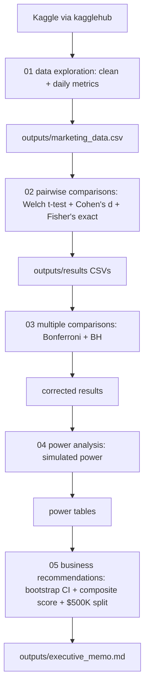
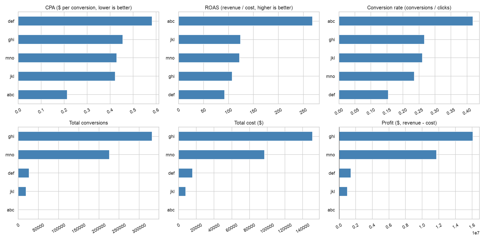
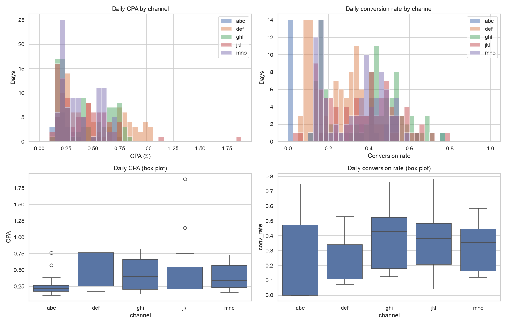
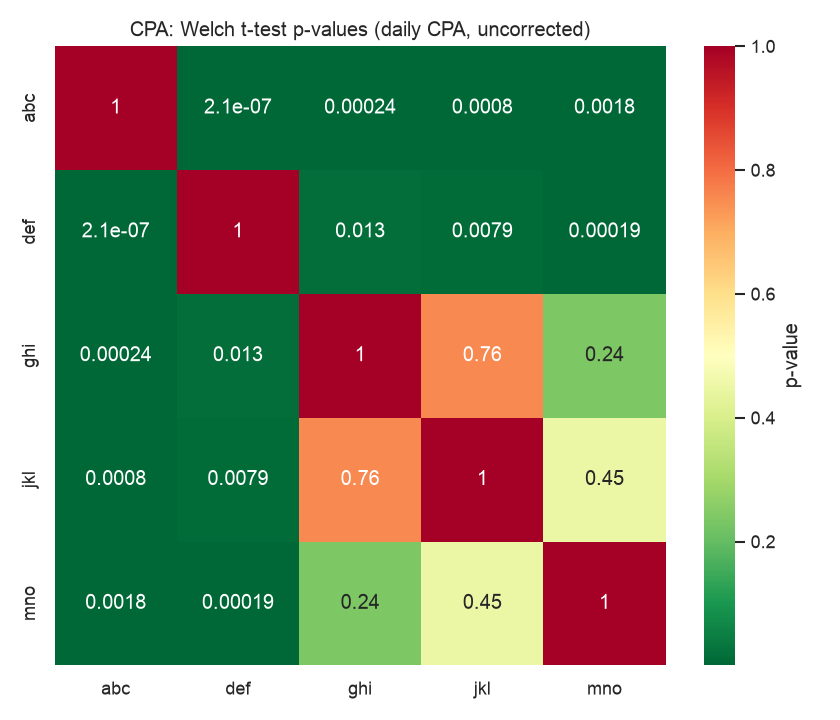
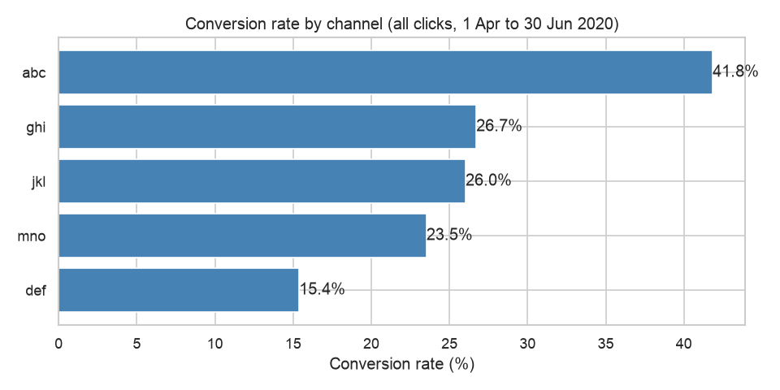
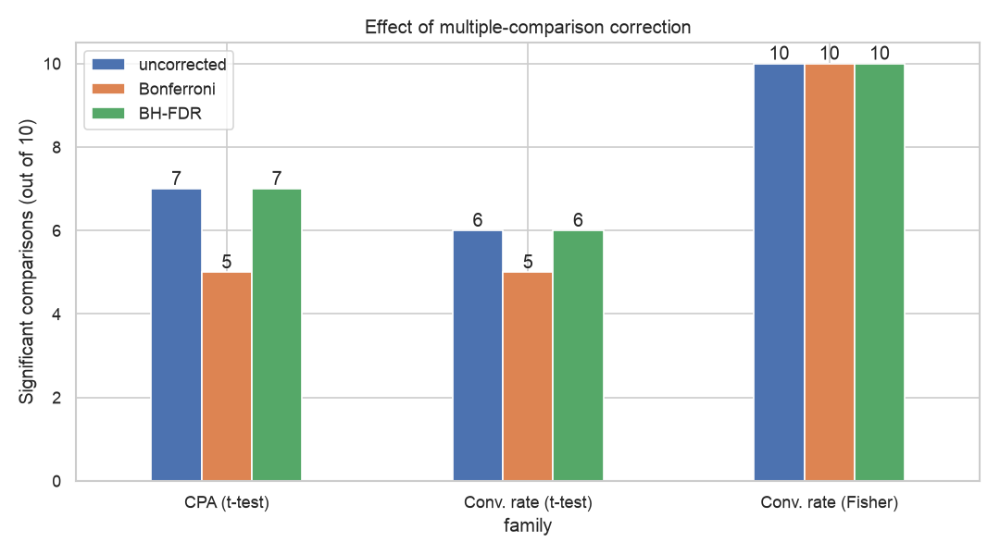
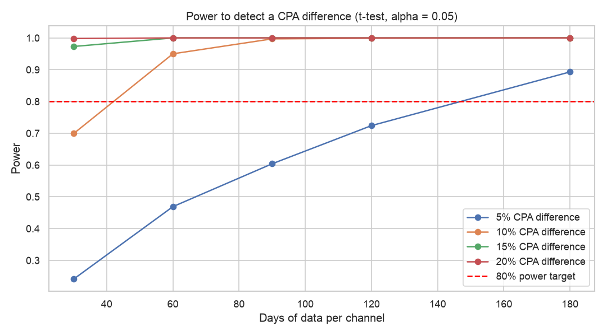

# Lab proof

## What this lab answers

I use a real advertising dataset to compare five placements with daily performance data. I check which gaps are supported by statistical tests and how much data the tests need. I use the results to make a cautious monthly budget recommendation.

| Deliverable | File |
|---|---|
| Data exploration (Part 1) | [01_data_exploration.ipynb](01_data_exploration.ipynb) |
| Statistical analysis (Parts 2-3) | [02_pairwise_comparisons.ipynb](02_pairwise_comparisons.ipynb) and [03_multiple_comparisons.ipynb](03_multiple_comparisons.ipynb) |
| Power analysis (Part 4) | [04_power_analysis.ipynb](04_power_analysis.ipynb) |
| Business recommendations (Part 5) | [05_business_recommendations.ipynb](05_business_recommendations.ipynb) and [outputs/executive_memo.md](outputs/executive_memo.md) |
| Reflection | [reflection.md](reflection.md) |

## Code / workflow

## One run with its input

I loaded Kaggle's `naniruddhan/online-advertising-digital-marketing-data` dataset with `kagglehub`. The notebook reports 15,408 source rows. After dropping the source `cost` column and mapping the analysis names, the raw working table has 15,408 rows and 13 columns.

| Cleaning step | Rows removed |
|---|---:|
| Exact duplicate rows | 5 |
| Rows without placement | 413 |
| Rows with clicks greater than impressions | 2 |
| Rows with conversions greater than clicks | 326 |
| Rows with negative metric values | 0 |

After cleaning, 14,662 source rows remain before aggregation. I map `placement` to `channel`, `displays` to `impressions`, and `post_click_conversions` to `conversions`. I map source `revenue` to Company X's `cost` and `post_click_sales_amount` to Company X's `revenue`. I drop the source `cost` because it describes the ad firm's cost to the publisher. I build dates using the year 2020.

The resulting [daily table](outputs/marketing_data.csv) has 455 rows and 7 columns: one row per date and placement, across five placements and 91 days from 1 April to 30 June 2020.

## Evidence

### Charts

*Channel totals show abc's low CPA and high ROAS, while ghi has the most conversions and spend.*

*The daily distributions show substantial spread and outliers, including extreme CPA days for jkl.*

*The heatmap shows uncorrected Welch test p-values for each daily CPA pair.*

*Pooled click conversion rates range from 41.8% for abc to 15.4% for def.*

*Bonferroni reduces significant results in the two daily metric families, while BH retains them.*

*The curves compare simulated power with the 80% target under a 15% daily CPA spread assumption.*

### Correction summary

| Comparison family | Tests | Uncorrected | Bonferroni | BH-FDR |
|---|---:|---:|---:|---:|
| CPA (Welch t-test) | 10 | 7 | 5 | 7 |
| Conversion rate (Welch t-test) | 10 | 6 | 5 | 6 |
| Conversion rate (Fisher's exact test) | 10 | 10 | 10 | 10 |
| **Total** | **30** | **23** | **20** | **23** |

### CPA pairs significant after BH

The means are daily CPA in dollars. Cohen's d is calculated for B minus A.

| Pair | Mean daily CPA A | Mean daily CPA B | BH adjusted p-value | Cohen's d |
|---|---:|---:|---:|---:|
| abc vs def | $0.257 | $0.510 | 2.09e-06 | +1.147 |
| abc vs ghi | $0.257 | $0.416 | 7.90e-04 | +0.826 |
| abc vs jkl | $0.257 | $0.405 | 2.01e-03 | +0.711 |
| abc vs mno | $0.257 | $0.381 | 3.65e-03 | +0.772 |
| def vs ghi | $0.510 | $0.416 | 1.80e-02 | -0.374 |
| def vs jkl | $0.510 | $0.405 | 1.32e-02 | -0.398 |
| def vs mno | $0.510 | $0.381 | 7.90e-04 | -0.567 |

### Minimum days for 80% power

| CPA gap | Minimum days | Status with 91 days |
|---:|---:|---|
| 5% | 145 | Insufficient |
| 10% | 40 | Sufficient |
| 15% | 20 | Sufficient |
| 20% | 15 | Sufficient |

## Final output

I saved the full recommendation in [outputs/executive_memo.md](outputs/executive_memo.md).

| Channel | Share | Monthly budget | Monthly spend today |
|---|---:|---:|---:|
| abc | 33.3% | $166,667 | $43 |
| jkl | 26.7% | $133,333 | $2,675 |
| mno | 20.0% | $100,000 | $31,949 |
| ghi | 13.3% | $66,667 | $49,801 |
| def | 6.7% | $33,333 | $5,136 |

My four strategic actions are:

1. Keep def at the bottom, at its 6.7% formula share or down to the 5% floor.
2. Fund ghi, jkl, and mno as one core tier because their CPA differences are not significant; use proven scale to split that tier.
3. Give abc a capped scale-up test, raise spend in steps, and watch CPA weekly.
4. Until abc proves it can scale, put the unused part of its share into the core tier.

